# A railway analogy for plugins and skills

An agent carrying out a requested task is like a train making a journey. The destination comes from the user's intended outcome. Workflows offer useful routes and stopping points; specialist expertise helps the agent make and verify decisions along the way.

## Map the parts

| Railway element | Collection concept | What follows |
| --- | --- | --- |
| Passenger needs and destination | Business strategy, product outcomes and acceptance | Establish who needs the result and how success will be recognized. |
| Rails and routes | Development and operations workflows | Choose a route appropriate to new work, an existing feature, a repair or an assessment. |
| Stations | Outcomes and decision points | Stop at the requested result: a design, verified implementation, assessment or authorized release. |
| Operating rules | Constraints and shared principles | Respect authority, privacy, compatibility, quality and recovery needs throughout the journey. |
| Signals and junctions | Decisions based on context and evidence | Continue, investigate, revise an assumption or ask about a consequential unresolved choice. |
| Locomotive and driver | Agent, model and execution harness | Interpret the request and perform work using the actual available tools and permissions. |
| Coupled carriages | Plugins | Select useful installation/update packages independently. Their physical order in the picture has no architectural meaning. |
| Operating and engineering manuals | Skills | Apply relevant expertise within the current task and accepted decisions. |
| Engineering disciplines | Generic application and supporting expertise | Reason about interfaces, services, data, security, delivery and operating behavior without selecting a technology. |
| Equipment-specific manuals | Technical expertise | Realize decisions using the accepted language, engine, framework, tool or platform. |
| Instruments and maintenance facilities | Verification, observability and operations | Gather evidence, diagnose problems, recover and feed learning into future work. |

## Follow a journey

For a tenant-isolation change, the destination is a defined access boundary that survives real application behavior. The agent examines existing decisions, establishes authority and isolation requirements, implements with the accepted stack, and verifies relevant allowed and denied operations. Available identity, database and testing expertise can deepen that work.

Without a database specialist, the agent still owns the isolation outcome and uses project evidence, general expertise and primary documentation. Without an execution target, it can complete useful design or code work but must report which behavior remains unverified. The missing manual and the unavailable locomotive are different limitations.

An architecture-only request ends at the design station. A small repair can enter near implementation and verification. Operating evidence can reopen an earlier product or design decision; the railway may be revisited rather than followed once from end to end.

## Where the analogy stops

Skills guide decisions. Tool and application controls enforce actual permissions; a signal in this illustration is not a permission mechanism. Installing a plugin does not authorize external changes, configure a live service or accept a technology.

The route is flexible. Stations are meaningful outcomes, not mandatory documents or required skill invocations. Carriages are optional packages, not a dependency chain. Generic activities remain useful without specialist packages, and specialists can answer a focused question independently of a complete development journey.

The [architecture](architecture.md) defines composition and fallback precisely. The [SDLC map](sdlc.md) explains lifecycle relationships and feedback; this analogy is a separate explanation of how guidance contributes to the work.
